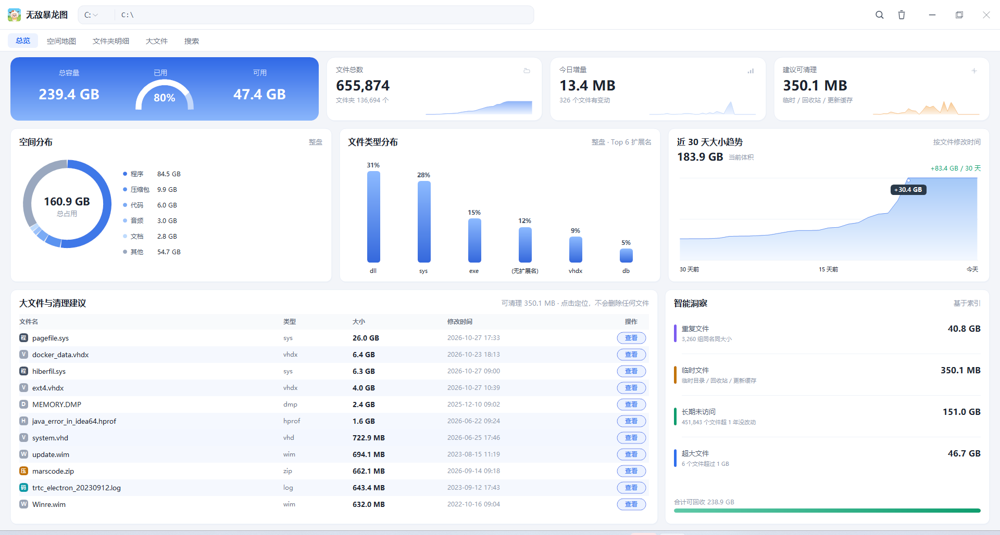

# PC Disk Workbench

> A **local-first** disk space workbench for Windows: scan, visualize, locate, and clean up your drives — everything happens on your own machine, nothing leaves it.

[](https://github.com/)
[](https://www.python.org/)
[](./requirements-optional.txt)
[](./LICENSE)

[简体中文](./README.md) ｜ **English**

---

## The problem

Windows' built-in Storage Sense tells you "drive C is almost full". It never tells you **which folder, which file type, or which year** is eating the space — and it certainly doesn't make cleanup feel safe.

PC Disk Workbench fills that gap:

- **See it** — treemap space map, file-type distribution, file-age distribution. Space hogs become obvious at a glance.
- **Find it** — a built-in SQLite index gives millisecond full-disk search by name or extension, plus a largest-files leaderboard.
- **Clean it safely** — **move-to-Recycle-Bin only**, never permanent deletion. Drive roots, `Windows`, `Program Files`, and user profile directories are refused outright, and every action is written to an audit log.
- **Share it** — export a self-contained HTML report or a single long image, or zip the whole tool and hand it to a colleague.

No network access, no uploads, no admin rights required. The backend binds to `127.0.0.1` only.



<p align="center"><sub>Native UI (<code>python app_win.py</code>) · Overview — space distribution, file types, 30-day growth, largest files and cleanup suggestions</sub></p>

---

## Features

| | |
| --- | --- |
| 🌐 **Three UIs** | Browser (web mode), WebView2 desktop window, or a Win32 + GDI native renderer with zero UI dependencies and the lowest memory footprint |
| 📊 **Overview** | Per-drive capacity KPIs, disk usage donut, file-type distribution, file-age distribution |
| 🗺 **Space map** | Treemap that exposes space hogs by area, with drill-down |
| 📁 **Folders** | Sortable table with breadcrumb navigation — read "how much does each subfolder take" directly |
| 🐘 **Large files** | Files above a threshold (50 MB by default), with multi-select actions |
| 🔍 **Search** | Built-in SQLite index (ms-level) with a live-walk fallback; reuses [Everything](https://www.voidtools.com/)'s index if it is installed |
| ♻️ **Safe cleanup** | Recycle Bin only + protected-path allowlist + `trash_log.txt` audit trail |
| 📤 **Sharing** | Self-contained HTML report / single long image, or package the tool itself as a zip |
| 🖱 **Handy actions** | Reveal in Explorer, put real files on the clipboard (paste straight into WeChat/QQ), create folders or empty files |
| ⚡ **Caching** | gzip-compressed scan cache + history trend, so reopening is instant |

---

## Quick start

### 1. Web mode (simplest)

```bash
git clone https://github.com/wxh-cloud/pc-disk-workbench.git
cd pc-disk-workbench
python server.py
```

Your browser opens `http://127.0.0.1:8733/` automatically. Close the terminal to stop the service.

On Windows you can also just double-click **`Start-Workbench.bat`** — it locates Python, picks a bindable port, and opens the browser.

> **About the port**: 8733 sometimes falls inside a Windows dynamic port reservation (`WinError 10013`).
> The server then walks forward to the next bindable port and prints the real URL.

### 2. Native desktop (no browser at all)

```bash
python app_win.py
```

Win32 + GDI rendering, **standard library only** — no browser engine is spawned, and memory usage is the lowest of all three modes.

### 3. WebView2 desktop window

```bash
pip install -r requirements-optional.txt
python build/launcher_native.py
```

Hosts the same web UI inside a native pywebview window. Requires the Edge WebView2 runtime (bundled with Windows 11; usually already present on Windows 10 via Edge).

### 4. Installer

Grab `个人磁盘工作台_安装包_*.exe` from [Releases](https://github.com/wxh-cloud/pc-disk-workbench/releases). It installs into your user profile and creates a desktop shortcut plus an uninstall entry.

> If no installer is attached yet, build one yourself — see [docs/BUILD.md](docs/BUILD.md). Running from source (options 1 and 2) gives you the exact same features, just without the shortcut and uninstall entry.

---

## Safety model

This is the part the project cares about most. These are hard constraints in code, not just documentation:

1. **No permanent deletion.** Every cleanup goes through `SHFileOperation` with `FOF_ALLOWUNDO` — Recycle Bin only, always recoverable.
2. **Protected paths are refused.** Drive roots (`C:\`), `Windows`, `Program Files`, `ProgramData`, user profile directories — matched and rejected before anything happens.
3. **Audit trail.** Each deletion (and each refusal) is timestamped into `trash_log.txt`.
4. **Loopback only.** The backend binds `127.0.0.1`; no port forwarding, no UPnP, no back door.
5. **Zero telemetry.** No analytics, no outbound requests — search, indexing, and reporting are all local.

---

## Project layout

```
pc-disk-workbench/
├── server.py                # Backend: local HTTP service, scan, index, recycle bin, sharing
├── index.html               # Frontend: single-file web UI (no build step, no npm, no CDN)
├── app_win.py               # Native UI: Win32 + GDI
├── Start-Workbench.bat      # One-click launcher for web mode
├── app.ico
├── requirements-optional.txt
├── build/                   # Packaging & distribution (PyInstaller)
│   ├── launcher_native.py   #   WebView2 window launcher
│   ├── assemble.py          #   Assemble a distributable folder (WebView2 build)
│   ├── assemble_native.py   #   Assemble a distributable folder (native build)
│   ├── setup_app.py         #   Installer / uninstaller
│   └── *.spec               #   PyInstaller configs
└── docs/
    ├── ARCHITECTURE.md      # Design, data flow, index schema, performance trade-offs
    ├── API.md               # Local HTTP API reference
    └── BUILD.md             # Packaging and release checklist
```

*(Project docs are currently written in Chinese; English translations are welcome.)*

---

## Requirements

- **Windows 10 / 11** — Win32 APIs are used directly (Recycle Bin, `CF_HDROP` clipboard, Explorer reveal).
- **Python 3.9+** — the core uses the standard library only.
- Optional: `pywebview` (WebView2 window mode), `pyinstaller` (self-packaging).

> macOS and Linux are not supported. The Win32-specific code is concentrated in a handful of functions, so a port is feasible — it just hasn't been done or verified here.

---

## Known limitations

- Scanning very large trees (tens of millions of files) raises memory usage noticeably and can grow `cache/index.db` to tens of MB. That is the price of speed; this project chose speed.
- Sizes come from `os.scandir` + `stat`. Hard links and sparse files are not deduplicated, so totals can occasionally exceed physical capacity.
- The first full scan takes as long as your disk and file count dictate — minutes on spinning disks.

---

## Contributing

Issues and PRs are welcome. Before submitting:

1. No new third-party runtime dependencies (keep the core stdlib-only).
2. Any change touching deletion must keep the "Recycle Bin only" guarantee.
3. Don't commit `cache/`, installers, or other local artifacts (`.gitignore` covers them).

---

## License

[MIT](./LICENSE)
