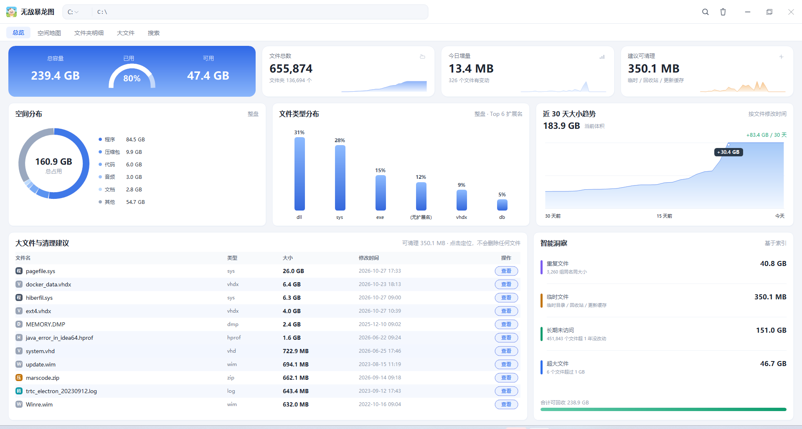

# PC Disk Workbench · 个人磁盘工作台

> 一个**纯本机运行**的 Windows 磁盘空间工作台：扫描、可视化、定位、安全清理，全部在一台电脑里完成，数据不出门。

[](https://github.com/)
[](https://www.python.org/)
[](./requirements-optional.txt)
[](./LICENSE)

**简体中文** ｜ [English](./README.en.md)

---

## 它解决什么问题

Windows 自带的「存储感知」只告诉你「C 盘快满了」，不会告诉你**到底是哪个文件夹、哪一类文件、哪一年的东西**在吃空间，更不会让你安心地清理。

PC Disk Workbench 就是补上这一段：

- **看得见** —— 空间地图（Treemap）、文件类型分布、文件年代分布，一眼看出体积堆积在哪里；
- **找得到** —— 内置 SQLite 极速索引，全盘按名字/类型毫秒级搜索，也能直接列出大文件排行；
- **清得安全** —— **只提供「移到回收站」**，不提供永久删除；系统目录、盘符根目录、用户个人文件夹一律拒绝删除，每次操作都写审计日志；
- **带得走** —— 一键生成可发送的 HTML 报告 / 长图，或者打包成 zip 直接发给同事。

整个过程**不联网、不上传、不需要管理员权限**，后端只监听 `127.0.0.1`。



<p align="center"><sub>原生界面（<code>python app_win.py</code>）· 总览页 —— 空间分布、文件类型、30 天增长趋势、大文件排行与清理建议</sub></p>

---

## 特性

| 能力 | 说明 |
| --- | --- |
| 🌐 **三种界面形态**  | 网页版（浏览器打开）、WebView2 桌面窗口版、Win32 + GDI 原生自绘版（零 UI 依赖，内存最低） |
| 📊 **总览** | 盘符容量 KPI、磁盘占用环形图、文件类型分布、文件年代分布 |
| 🗺 **空间地图** | Treemap 矩形树图，按面积直观暴露空间黑洞，支持逐层下钻 |
| 📁 **文件夹明细** | 可排序表格 + 面包屑导航，直接读出「每个子目录占多少」 |
| 🐘 **大文件** | 超过阈值的大文件排行（默认 50 MB），支持批量勾选处理 |
| 🔍 **搜索** | 内置 SQLite 索引（毫秒级）/ 实时遍历兜底；若本机装了 [Everything](https://www.voidtools.com/)，自动复用它的索引 |
| ♻️ **安全清理** | 只移入回收站 + 受保护路径白名单 + `trash_log.txt` 审计 |
| 📤 **分享** | 生成自包含 HTML 报告 / 单张长图；或把整个工具打包成 zip 发给别人 |
| 🖱 **实用小动作** | 在资源管理器中定位、把真实文件放进剪贴板（可直接粘贴进微信/QQ 发送）、新建文件夹/空文件 |
| ⚡ **缓存** | 扫描结果 gzip 缓存 + 历史趋势，二次打开秒出 |

---

## 快速开始

### 方式一：网页版（最简单）

```bash
git clone https://github.com/wxh-cloud/pc-disk-workbench.git
cd pc-disk-workbench
python server.py
```

浏览器会自动打开 `http://127.0.0.1:8733/`。关闭终端窗口即停止服务。

Windows 用户也可以直接双击 **`Start-Workbench.bat`** —— 它会自动找 Python、自动挑一个能绑定的端口，再拉起浏览器。

> **端口说明**：8733 有时会落进 Windows 的动态保留端口区间（表现为 `WinError 10013`），
> 此时服务会自动顺延到下一个可用端口，并在控制台打印真实地址。

### 方式二：桌面版（原生窗口，无需浏览器）

```bash
python app_win.py
```

Win32 + GDI 自绘界面，**只依赖 Python 标准库**，不拉起任何浏览器内核，内存占用最低。

### 方式三：WebView2 桌面窗口

```bash
pip install -r requirements-optional.txt
python build/launcher_native.py
```

以 pywebview 原生窗口承载同一套前端。需要系统已安装 Edge WebView2 运行时（Win11 自带，Win10 多数已随 Edge 安装）。

### 方式四：安装包

从 [Releases](https://github.com/wxh-cloud/pc-disk-workbench/releases) 下载 `个人磁盘工作台_安装包_*.exe`，双击安装到当前用户目录，自动创建桌面快捷方式与卸载入口。

> Releases 里暂时没有安装包时，可自行打包：见 [docs/BUILD.md](docs/BUILD.md)。也可以直接跑源码（方式一 / 方式二），功能完全一致，只是少了桌面快捷方式。

---

## 安全边界

这是本项目最在意的部分，代码里是硬约束，不是提示文案：

1. **没有永久删除**。所有清理动作走 `SHFileOperation` 的 `FOF_ALLOWUNDO`，只能进回收站，随时可以还原。
2. **受保护路径一律拒绝**。盘符根目录（`C:\`）、`Windows`、`Program Files`、`ProgramData`、用户配置目录等命中即拒绝，连尝试都不做。
3. **审计留痕**。每次删除/拒绝都按时间写入 `trash_log.txt`。
4. **只监听回环地址**。后端绑定 `127.0.0.1`，不做端口转发、不起 UPnP、不留后门。
5. **零遥测**。没有任何统计上报，没有任何外发请求（搜索/索引/报告全在本机完成）。

---

## 目录结构

```
pc-disk-workbench/
├── server.py                # 后端：本地 HTTP 服务、扫描、索引、回收站、分享
├── index.html               # 前端：单文件 Web UI（无构建步骤、无 npm、无 CDN）
├── app_win.py               # 原生界面：Win32 + GDI 自绘
├── Start-Workbench.bat      # Windows 一键启动（网页版）
├── app.ico
├── requirements-optional.txt
├── build/                   # 打包与分发（PyInstaller）
│   ├── launcher_native.py   #   WebView2 窗口启动器
│   ├── assemble.py          #   组装可分发目录（WebView2 版）
│   ├── assemble_native.py   #   组装可分发目录（原生版）
│   ├── setup_app.py         #   安装 / 卸载程序
│   └── *.spec               #   PyInstaller 配置
└── docs/
    ├── ARCHITECTURE.md      # 架构、数据流、索引设计、性能取舍
    ├── API.md               # 本地 HTTP API 参考
    └── BUILD.md             # 打包与分发流程
```

---

## 文档

- [架构说明](docs/ARCHITECTURE.md) —— 三层结构、扫描管线、SQLite 索引 schema、内存与端口上的取舍
- [API 参考](docs/API.md) —— 全部 `/api/*` 端点与参数
- [打包分发](docs/BUILD.md) —— PyInstaller 打包、安装器组装、发布清单

---

## 环境要求

- **Windows 10 / 11**（深度依赖 Win32 API：回收站、剪贴板 `CF_HDROP`、资源管理器定位）
- **Python 3.9+**（核心功能只用标准库）
- 可选：`pywebview`（WebView2 窗口版）、`pyinstaller`（自行打包）

> macOS / Linux 暂不支持。代码里 Win32 相关的部分集中在少数函数中，移植是可行的，但没有在本项目范围内验证过。

---

## 已知限制

- 扫描超大目录（千万级文件）时内存会明显上涨，索引库 `cache/index.db` 可能达到数十 MB —— 这是磁盘分析的固有成本，本项目选择了「快」。
- 文件大小来自 `os.scandir` 的 `stat`，对硬链接/稀疏文件不做去重，可能出现「总和大于磁盘容量」。
- 初次全盘扫描耗时取决于磁盘速度与文件数量，机械盘上可能需要几分钟。

---

## 贡献

欢迎 Issue 与 PR。提交前请确认：

1. 不引入第三方运行时依赖（核心路径保持只用标准库）；
2. 任何涉及删除的改动，必须仍然「只能进回收站」；
3. 不要提交 `cache/`、安装包等本机产物（`.gitignore` 已覆盖）。

---

## 许可证

[MIT](./LICENSE)
