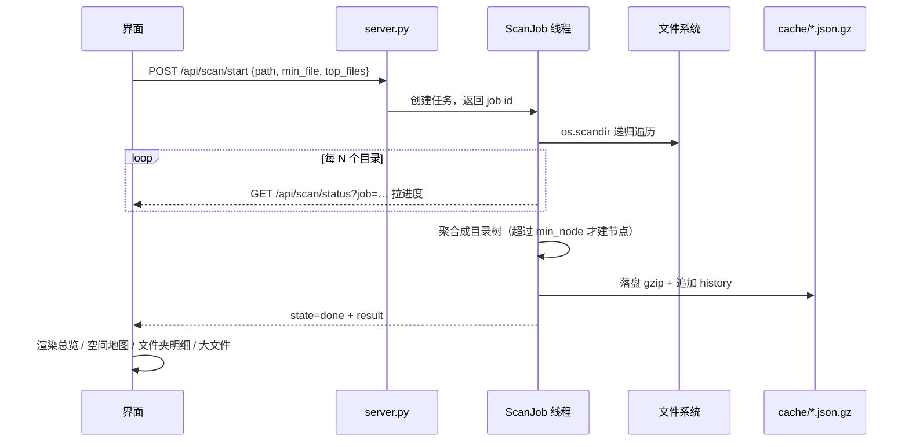

# 架构说明

本文说明 PC Disk Workbench 的整体结构、关键数据流，以及几个看起来"反直觉"的设计取舍。

---

## 1. 设计目标

| 目标 | 做法 |
| --- | --- |
| **不依赖任何第三方库** | 后端只用 Python 标准库（`http.server` / `sqlite3` / `ctypes`）；前端不引用任何 CDN，单文件内联 CSS/JS |
| **数据不出本机** | 服务只绑 `127.0.0.1`；无遥测、无外发请求；不引入任何云服务 |
| **删不掉不该删的东西** | 只有「移到回收站」一条路径；受保护路径在进入系统调用前就被拦截 |
| **不装也能用** | 有 Python 就能跑；想脱离命令行就打成 exe；想要原生感就用 GDI 版 |
| **快** | 扫描结果缓存 + SQLite 索引，二次打开秒出，搜索毫秒级 |

---

## 2. 三层结构

```
┌──────────────────────────────────────────────────────────┐
│  界面层（三选一，共享同一套语义）                          │
│  ① index.html     单文件 Web UI，浏览器 / WebView2 承载    │
│  ② app_win.py     Win32 + GDI 自绘，零 UI 依赖            │
└───────────────────────────┬──────────────────────────────┘
                            │ HTTP / 进程内函数调用
┌───────────────────────────▼──────────────────────────────┐
│  服务层  server.py                                       │
│  · ThreadingHTTPServer（仅 127.0.0.1）                    │
│  · 静态文件（index.html） + /api/* 接口                    │
│  · ScanJob：后台扫描线程                                  │
│  · IndexEngine：SQLite 全盘索引                           │
│  · Win32 能力：回收站 / 剪贴板 / 资源管理器定位             │
└───────────────────────────┬──────────────────────────────┘
                            │
┌───────────────────────────▼──────────────────────────────┐
│  数据层  cache/                                          │
│  · <盘符>.json.gz   扫描结果缓存（gzip JSON）             │
│  · index.db         全盘索引（SQLite）                    │
│  · history.json     同一路径的历史体积趋势                │
│  · share/           导出的报告 / 长图 / 分享包            │
└──────────────────────────────────────────────────────────┘
```

`app_win.py` 虽然不用 HTTP，但它 `import server` 后**直接调用同一批函数**，所以两种界面的行为天然一致，不存在"网页版修了、原生版没修"的分叉。

---

## 3. 扫描管线

一次扫描的完整链路：



要点：

- **`ScanJob` 是 `threading.Thread` 子类**，状态机 `running → done | aborted | error`，前端靠轮询 `/api/scan/status` 取 `dirs / files / errors / elapsed`。
- **节点门槛 `min_node`**：太碎的子目录不进结果树，避免几十万节点撑爆前端渲染。
- **`min_file` 默认 50 MB**，只用于「大文件」榜单，不影响总量统计。
- **`ALL` 特殊值**：把本机所有固定盘合并成一棵树，缓存键固定为 `ALL`，否则前端会把盘符页签误切到第一个盘。
- **缓存键**来自 `cache_key(path)`：盘符 → 盘符名，任意路径 → 路径哈希。
- **`migrate_cache_to_gzip()`** 在服务启动时把旧版明文 `.json` 缓存迁移成 `.json.gz`，省一半以上体积。

---

## 4. 索引引擎（`IndexEngine`）

Everything 是闭源软件，无法内嵌，所以这里自研了一套最小可用实现：

- 后台守护线程遍历全盘，把 **文件名 / 所在目录 / 是否目录 / 大小 / 修改时间** 写进 SQLite；
- **建索引期间也能搜**（自动降级为实时遍历），建好后直接查 SQL；
- **增量刷新**：按 `mtime` 只补扫上次索引之后变动的条目；
- **可限定范围**：只索引某个盘或某几个目录。

Schema（v3）：

```sql
PRAGMA user_version = 3;

CREATE TABLE dir   (id INTEGER PRIMARY KEY, p TEXT NOT NULL);
CREATE TABLE entry (
    n   TEXT,     -- 名字（仅叶子名，不含路径）
    dir INTEGER,  -- 指向 dir.id
    d   INTEGER,  -- 1 = 目录，0 = 文件
    s   INTEGER,  -- 字节数
    m   INTEGER   -- mtime
);
CREATE INDEX ix_n ON entry(n COLLATE NOCASE);
```

设计取舍：

- **名字与路径分表**，避免每条记录重复存整条长路径——百万级条目下这是最大的空间节省。
- **`dir.p` 不加 UNIQUE**：写入走批量 `executemany`，唯一约束会让插入变慢，而去重由遍历逻辑本身保证。
- **跳过目录**：`$recycle.bin`、`System Volume Information`、`WinSxS`、`node_modules`、`.git`、`__pycache__` 等不索引——它们要么无意义，要么会把条目数翻倍。
- **`SCHEMA_VERSION` 是硬开关**：改 schema 必须递增它，旧库会被直接 `DROP` 重建，不做迁移（索引本来就是可再生数据）。
- **`try_restore(ttl=12h)`**：服务重启后如果索引库存在且 12 小时内构建，直接置为 `ready`，避免每次开应用都全盘重扫。

---

## 5. 安全层

清理是本项目唯一有破坏性的能力，因此每一层都设了闸：

1. **受保护路径判定** `is_protected(path)` —— 盘符根、`Windows`、`Program Files*`、`ProgramData`、用户配置目录等命中即返回原因，直接拒绝并记日志，**不进入系统调用**。
2. **只有回收站** `to_recycle_bin(path)` —— 走 `SHFileOperationW` + `FOF_ALLOWUNDO | FOF_NOCONFIRMATION`，并允许文件夹；不提供 `os.remove` 之类的永久删除入口。
3. **审计** `log_trash(path, note)` —— 时间戳 + 动作 + 体积，追加写入 `trash_log.txt`。
4. **前端不做静默删除** —— 所有批量操作必须经确认对话框，且会先跑一遍受保护路径校验再逐条提交。

> 换句话说：即使有人直接 `curl` 打 `/api/trash`，也过不了受保护路径这一关。

---

## 6. 端口选择

`server.py` 不假设 8733 可用。Windows 的动态保留端口区间（`netsh interface ipv4 show excludedportrange protocol=tcp`）会周期性变化，877x 段落经常被 Hyper-V / WSL / Docker 占走，表现是 bind 时 `WinError 10013`。

`bind_server(start, tries=300)` 的做法是**直接真实绑定、失败就顺延**：从 `start` 起最多试 300 个端口，返回「已 listen 的 server + 实际端口」。`--print-port` 参数让启动脚本能先探到真实端口，再拼出正确的 URL。

---

## 7. 性能取舍（原生版与 WebView2 版）

| 形态 | 主要开销 | 实测私有内存 |
| --- | --- | --- |
| 网页版（浏览器） | 整个浏览器进程 | 取决于浏览器 |
| WebView2 窗口版 | WebView2 多进程模型 | ≈ 420 MB |
| 原生 GDI 版 | 只有一个进程 + GDI 双缓冲位图 | 一个数量级更低 |

WebView2 版通过 `WEBVIEW2_ADDITIONAL_BROWSER_ARGUMENTS` 精简内存（`--disable-gpu`、`--renderer-process-limit=1`、`--process-per-site`、限制 JS 堆等）。

**两个踩过的坑，写在这里避免后来者重复：**

- ❌ **不要加 `--single-process`**：实测约 30 秒后渲染进程崩溃，整个应用退出。
- ❌ **空白页在 WebView2 下也要 ~224 MB 工作集**：所以「把它压到 50 MB」这个目标在 WebView2 上不可能达成，只能换原生渲染——这就是 `app_win.py` 存在的原因。

---

## 8. 前端为什么是单文件

`index.html` 一个文件里装着全部 CSS 与 JS（约 4500 行），没有构建步骤、没有 npm、没有 CDN 引用。原因：

- 用户可能在一台**离线**的电脑上打开它，任何外部资源都会变成白屏；
- `share/package` 功能会把整个工具打成 zip 发给别人，单文件保证解压即用；
- 桌面版（WebView2 / GDI）直接复用同一个文件，无需打包前端产物。

代价是文件偏大、多人协作时容易冲突。这是有意识的取舍：**可分发性 > 开发便利性**。
